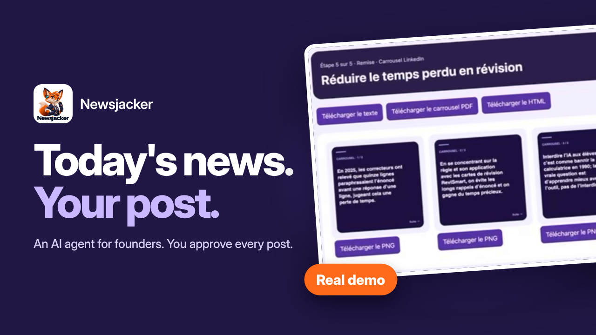

# Newsjacker Agent

Newsjacker is an AI agent for founders. It watches the news in your field, finds a recent, dated story worth reacting to, and drafts a LinkedIn post or carousel in your voice. **Nothing goes out without your approval.**

Built with n8n by Alejandra Neira, Salome Pkhakadze, Assem El Abrak and Marcy Hobman (HETIC, *AI Agents for Founders* challenge).

- Demo video (4 min): [YouTube link](#) <!-- replace with the unlisted YouTube URL -->
- Workflow export: [`workflow/newsjacker-agent-v1.json`](workflow/newsjacker-agent-v1.json)
- AI disclosure: [`docs/AI-DISCLOSURE.md`](docs/AI-DISCLOSURE.md)

---

## 1. Free access (no account, no setup)

**Open the form:** https://assemeak.app.n8n.cloud/form/founder-post-agent-carnet

It runs on our n8n instance with our free-tier API keys. You don't need any login or key. One run takes about 3 minutes, including your own inputs.

### Ready-to-use example

Copy these values. This profile was tested on 20 November 2026 and returned two dated press sources (Le Figaro, Le Monde).

| Field | Value |
|---|---|
| Nom de l'entreprise | `Kerfact` |
| Pitch en une phrase | `Kerfact aide les TPE et les artisans à passer à la facturation électronique obligatoire : choix de la plateforme agréée, réception et envoi des factures, sans changer leurs habitudes.` |
| Site web / réseaux sociaux | leave empty |
| *Step 2* · Secteur | `facturation électronique` |
| *Step 2* · Mots-clés | `facturation électronique, TPE, PME, plateforme agréée` |
| *Step 2* · Sujets à suivre | `facturation électronique` (one topic works best) |
| *Step 2* · Fréquence | `Une seule fois` |
| *Step 3* · Format | `Carrousel LinkedIn` or `Post LinkedIn` |

Tip: keep **one concrete topic** in "Sujets à suivre". Several topics in one field dilute the search and often return evergreen guides, which the agent rejects.

### What happens, and when you decide

| Step | The agent | You |
|---|---|---|
| 1. Company | — | Name and one-sentence pitch |
| 2. Profile | Drafts sector, keywords and topics | **Check and correct every field**, pick tone and frequency |
| 3. Sources and angles | Searches the last 30 days, drops undated, vendor, legal and FAQ pages, proposes up to 3 angles, each tied to a source | **Choose the angle**, add your own view (optional), pick the format |
| 4. Draft | Writes the post, lists each claim with the source excerpt that supports it | **Edit the text**, then *Valider le contenu* or *Écarter le brouillon* |
| 5. Delivery | Gives the text, the carousel PDF and PNG slides (or the image) | Download and post, or use *Publier sur LinkedIn* (see limits) |

### What a usable output looks like

- 1 to 2 source cards with title, outlet, date and a working "Lire l'article" link.
- A draft whose every factual sentence matches an excerpt shown under *Sources*.
- For a carousel: 3 slides of 240 characters max, plus a 3-page PDF.

**Check one thing yourself:** open the source link and confirm the fact and the date used in the draft. If the date is uncertain, the form asks you to confirm it before drafting.

### When there is no output

If no recent, relevant story exists, the agent stops **without calling the AI model** and lists why each source was rejected (too old, not an article, already used…). Change the topic and run again.

---

## 2. Run it on your own n8n (setup guide)

Use this if you want to reuse the agent with your own keys. Every service below has a free tier.

### Requirements

- n8n with **Data Tables** support (n8n Cloud, or self-hosted community edition, recent version).
- Free accounts and keys:
  - **Tavily** (news search and page extraction)
  - **Groq** (LLM, model `openai/gpt-oss-120b`)
  - **Cloudflare Workers AI** (image, model `@cf/black-forest-labs/flux-1-schnell`), only for the "post + image" format
  - **LinkedIn** OAuth app, only if you want direct publishing (optional)
- Jina Reader is called without a key.

### Steps

1. **Import** `workflow/newsjacker-agent-v1.json` in n8n (*Workflows › Import from file*).
2. **Create the credentials** and attach them to the nodes:

   | Credential type | Name in the export | Nodes |
   |---|---|---|
   | Header Auth (`Authorization: Bearer YOUR_TAVILY_KEY`) | Header Auth account | `2. Search news (Tavily)`, `1b2a. Lire les pages publiques` |
   | Groq | Groq account | the 3 *Groq Chat Model* nodes |
   | Cloudflare | Cloudflare account | `5d. Generate image (Cloudflare Workers AI)` |
   | LinkedIn OAuth2 (optional) | LinkedIn account | `7b`, `7b2`, `7b4`, `7b5` |

3. **Replace the placeholders** in the export:
   - `YOUR_CLOUDFLARE_ACCOUNT_ID` in the URL of node `5d`.
   - `YOUR_LINKEDIN_PERSON_ID` in node `7b` (only if you publish).
   - The contact e-mail shown in the privacy notice of the forms, if you run it for other people.
4. **Create 4 Data Tables** and re-select them in every *Data Table* node:

   | Table | Columns used |
   |---|---|
   | `fpa_founder_profiles` | profile_key, startup_name, profile_json, active, content_type, writing_language, schedule_days, schedule_time, timezone, last_slot_key, last_successful_run |
   | `fpa_review_queue` | run_id, profile_key, slot_key, status, shortlist_json, profile_json, submitted_at |
   | `fpa_seen_urls` | profile_key, url, first_seen |
   | `fpa_gated_assets` | asset_id, run_id, version, status, filename, pdf_base64, landing_copy_json, storage_ref |

5. **Publish** the workflow and open the form URL shown on node `1. Receive founder profile` (path `founder-post-agent-carnet`).
6. Run the Kerfact example above. You should reach step 3 with dated sources.

### Direct LinkedIn publishing (optional)

The carousel route calls the LinkedIn Documents API through *HTTP Request* nodes. In n8n, open the **LinkedIn account** credential and set **Allowed HTTP Request Domains** to *Specific domains* with `api.linkedin.com, www.linkedin.com`. With the default *None*, n8n blocks the call and the agent falls back to the manual handoff.

---

## 3. How it handles errors

| Situation | What the agent does |
|---|---|
| Profile incomplete | Pre-fills the gaps with AI, you review them; stops only if still invalid |
| No recent, relevant news | Stops before any LLM call and explains why each source was rejected |
| Page can't be read | Falls back to the search text, else drops the article |
| Source date uncertain | Drops it if dated sources exist, otherwise asks you to confirm |
| Link not in the sources | Blocks delivery, even after your edits |
| Image generation fails | Keeps the text and the visual brief |
| You reject or stop | Ends the run, nothing is published |

---

## 4. Honest limits

- **Direct LinkedIn publishing of carousels** needs the credential setting above; on our instance it is still being finalised. The manual handoff (download, then post) always works.
- **Free tiers have quotas** (Tavily, Groq, Cloudflare). If a quota is reached, the run stops with a "service unavailable" message.
- The agent can only use what search returns: niche topics with little press coverage often end with "no relevant news".
- Inputs are sent to AI and web services, some outside the EU. Do not enter sensitive personal data.
- Drafts are proposals. The founder stays responsible for what is published.

---

## 5. Test log (fiche de reprise)

| Date | Tester | Scenario | Verdict |
|---|---|---|---|
| 2026-11-20 | Team (Assem) | Kerfact, carousel | Sources found, draft approved, manual handoff OK; direct LinkedIn carousel blocked by credential setting |
| _to fill_ | _partner team_ | _from this guide only_ | _to fill_ |

V1 export: `workflow/newsjacker-agent-v1.json` (20 Nov 2026). No API key or secret is included: credentials are referenced by name only and account identifiers are replaced by placeholders.
